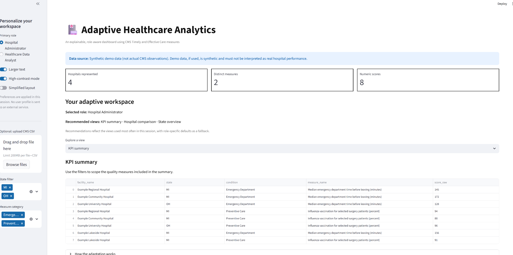
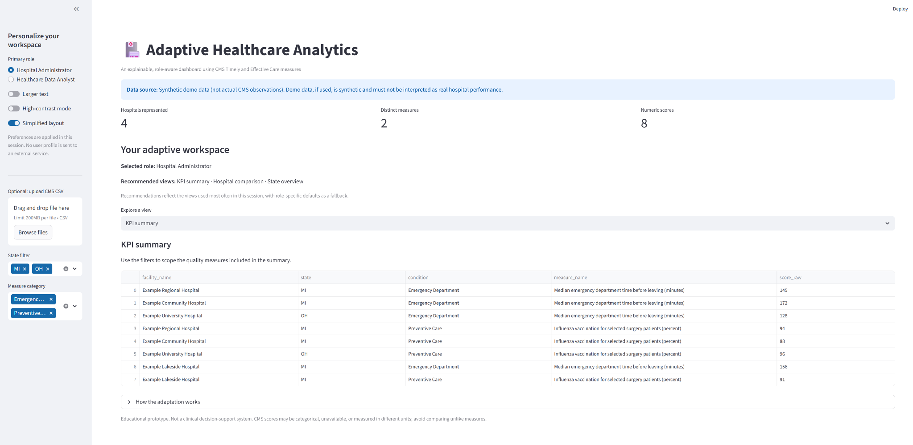
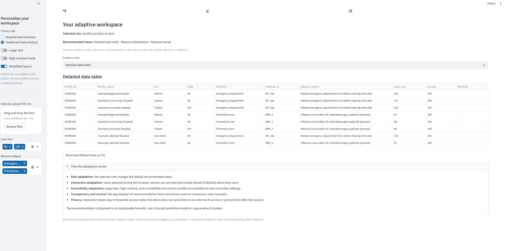
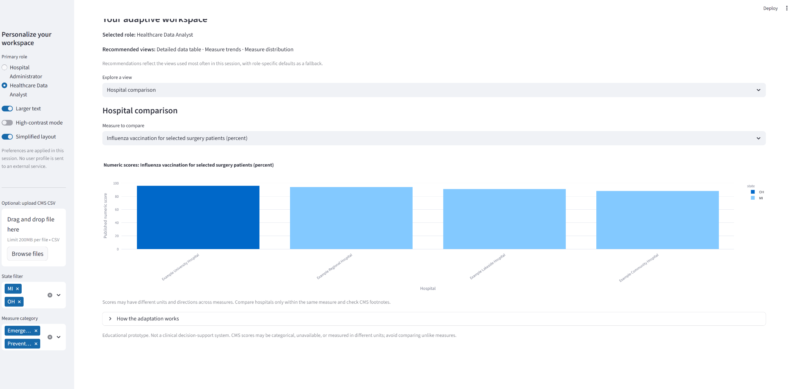
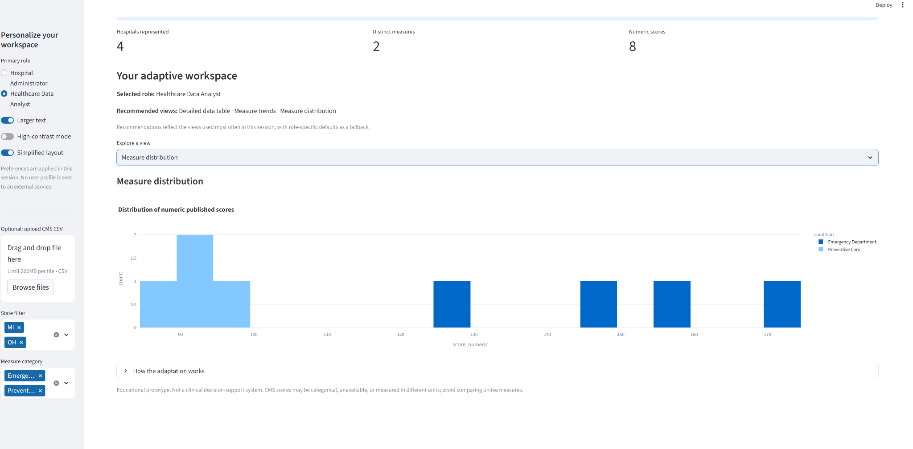

# Adaptive Healthcare Analytics

**An AI-informed, adaptive healthcare analytics dashboard built with Streamlit, Python, pandas, Plotly, and scikit-learn.**

This project demonstrates how an interface can adapt to the needs of different users while they explore hospital quality measures. The primary audiences are **hospital administrators** who need a high-level overview and **healthcare data analysts** who need more detailed records and exploratory views.

> **Important data note:** The screenshots below use synthetic demonstration records. These examples are not actual CMS hospital observations. Upload the official CMS CSV to explore the real dataset.

## Table of contents

- [Project goals](#project-goals)
- [Features](#features)
- [Screenshots](#screenshots)
- [How the adaptive behavior works](#how-the-adaptive-behavior-works)
- [Data source and handling](#data-source-and-handling)
- [Project structure](#project-structure)
- [Run the application](#run-the-application)
- [Run the tests](#run-the-tests)
- [Limitations and privacy](#limitations-and-privacy)
- [AI assistance disclosure](#ai-assistance-disclosure)
- [References](#references)

## Project goals

The goal is to demonstrate an **adaptive user interface (AUI)** for healthcare analytics. Rather than presenting every user with exactly the same starting experience, the application uses the selected role, accessibility preferences, and in-session view selections to personalize navigation and recommendations.

This is an educational prototype for human-computer interaction (HCI). It is not a clinical decision-support product.

## Features

- **Role-aware experience:** choose Hospital Administrator or Healthcare Data Analyst.
- **Adaptive view recommendations:** suggests relevant dashboard views based on role and the views selected during the current session.
- **Accessibility preferences:** toggle larger text, high-contrast styling, and a simplified layout.
- **Data exploration:** filter by state and measure category.
- **Multiple views:** KPI summary, hospital comparison, state overview, measure trends when usable date data is present, detailed data table, and measure distribution.
- **CSV support:** upload a CMS CSV from the sidebar or place it at `data/cms_hospital_raw.csv`.
- **Data cleaning:** normalizes common CMS column names and converts numeric scores when possible while retaining the original score text.
- **Export:** download the currently filtered records as CSV from the detailed data table.
- **Transparency:** explains the adaptation logic and labels the synthetic-data fallback.
- **Automated tests:** tests cover data cleaning and core adaptation logic.

## Screenshots

The images below are stored in this repository under `screenshots/` and are embedded using relative paths so GitHub can render them in this README.

### 1. Administrator dashboard — default view

Shows the dashboard's summary metrics, role-specific recommendations, filters, and initial summary view.


### 2. High-contrast accessibility setting

Shows the dashboard with high-contrast styling enabled.



### 3. Simplified layout

Shows the simplified presentation setting, intended to reduce interface complexity.



### 4. Healthcare analyst — detailed data table

Shows the analyst-oriented detailed records and CSV export control.



### 5. Hospital comparison

Shows a comparison chart for one selected measure. Interpret scores only within the same measure and check the CMS definition and footnotes.



### 6. Measure distribution

Shows the distribution of numeric scores in the selected filtered records.



*All screenshots currently demonstrate the synthetic demo dataset unless the data-source banner in the captured screen explicitly says otherwise.*

## How the adaptive behavior works

### Role adaptation

The role selection changes the default recommended views:

- **Hospital Administrator:** KPI summary, hospital comparison, and state overview.
- **Healthcare Data Analyst:** measure trends, detailed data table, and measure distribution.

### Interaction-based recommendations

The application keeps a bounded history of selected view names in Streamlit session state. The recommender uses:

1. **TF-IDF** to represent descriptions of the available dashboard views as text vectors.
2. **Cosine similarity** to compare a role-and-history profile with available views.
3. **Interaction frequency** to give additional weight to views repeatedly selected in the current session.
4. **Role defaults** to keep recommendations relevant to the selected audience.

This is a small, explainable content-based recommendation model. It is **not** a large language model, generative AI, or a clinically validated predictive model. The user can still manually select an available view.

### Accessibility adaptation

The sidebar offers three user-controlled settings:

- **Larger text** increases text size.
- **High-contrast mode** adds stronger contrast and borders.
- **Simplified layout** removes the detailed-table option from the view selector to reduce the initial interface complexity.

These settings are optional and do not infer a user's disability or health status.

## Data source and handling

The intended public dataset is the Centers for Medicare & Medicaid Services (CMS) **Timely and Effective Care - Hospital** dataset.

- Dataset page: https://data.cms.gov/provider-data/dataset/yv7e-xc69
- Data catalog: https://data.cms.gov/provider-data/

To load the full dataset, download its CSV and either:
- save it as `data/cms_hospital_raw.csv`, or
- upload it using the sidebar file uploader.

The complete CMS CSV is intentionally not included in this repository. When no CSV is found or uploaded, the application uses clearly labeled synthetic demonstration records so the interface can still be explored.

CMS measures may have different units, meanings, directions, or categorical values. Do not compare unlike measures or interpret a higher numeric score as universally better. Review measure definitions, reporting periods, and footnotes.

## Project structure

```text
adaptive-healthcare-analytics/
├── app.py                         # Streamlit interface and dashboard views
├── src/
│   ├── adaptation.py               # Role-aware recommendations and layout logic
│   └── data_utils.py               # CSV loading, normalization, and demo data
├── tests/
│   ├── test_adaptation.py          # Adaptation behavior tests
│   └── test_data_utils.py          # Data cleaning tests
├── data/
│   └── README.md                   # Instructions for adding the CMS CSV locally
├── screenshots/
│   ├── 01_admin_default_dashboard.png
│   ├── 02_accessibility_high_contrast.png
│   ├── 03_simplified_layout.png
│   ├── 04_analyst_detailed_table.png
│   ├── 05_hospital_comparison.png
│   └── 06_measure_distribution.png
├── .streamlit/
│   └── config.toml                 # Streamlit theme configuration
├── requirements.txt
├── TEST_RESULTS.txt
├── SUBMISSION_CHECKLIST.md
└── README.md
```

## Run the application

### Requirements

- Python 3.10 or later recommended
- pip
- Windows PowerShell, macOS Terminal, or a compatible shell

### Windows PowerShell

Clone the repository and move into the project folder:

```powershell
git clone https://github.com/sudheera96/adaptive-healthcare-analytics.git
cd adaptive-healthcare-analytics
py -m venv .venv
.\.venv\Scripts\Activate.ps1
python -m pip install --upgrade pip
python -m pip install -r requirements.txt
streamlit run app.py
```

Streamlit prints a local URL in the terminal; open that URL in your browser.

### macOS or Linux

```bash
git clone https://github.com/sudheera96/adaptive-healthcare-analytics.git
cd adaptive-healthcare-analytics
python3 -m venv .venv
source .venv/bin/activate
python -m pip install --upgrade pip
python -m pip install -r requirements.txt
streamlit run app.py
```

## Run the tests

With the virtual environment activated, run:

```bash
python -m unittest discover -s tests -v
```

The committed test log records **7 tests passing** for the tested data-cleaning and adaptation functions. Re-run the tests after making changes; the log is a snapshot and does not replace a fresh test run.

## Limitations and privacy

- This is a classroom HCI/analytics prototype, not a clinical decision-support system.
- The recommendations are for dashboard navigation, not for diagnosing patients, recommending treatments, or ranking hospitals clinically.
- The fallback records are synthetic and must not be cited as real hospital performance.
- Interaction history is kept in the current Streamlit session and is not sent to an external AI service by the recommendation component.
- The app is designed for public provider-level data; do not upload patient-identifiable or otherwise sensitive data.
- Accessibility controls provide a few user-selected options; they do not establish full WCAG conformance or replace accessibility testing with assistive technologies.
- Confirm CMS column names and data definitions for the specific CSV release being used.

## AI assistance disclosure

ChatGPT assisted with project planning, code drafting, test design, README/documentation, and report drafting. The implementation uses scikit-learn TF-IDF and cosine similarity for content-based view recommendations; it does not call a generative AI model. 

## References

Centers for Medicare & Medicaid Services. (n.d.). *Timely and Effective Care - Hospital*. CMS Provider Data Catalog. https://data.cms.gov/provider-data/dataset/yv7e-xc69

scikit-learn developers. (n.d.). *Pairwise metrics, affinities, and kernels*. scikit-learn documentation. https://scikit-learn.org/stable/modules/metrics.html

Streamlit. (n.d.). *Session State*. Streamlit documentation. https://docs.streamlit.io/develop/api-reference/caching-and-state/st.session_state

Streamlit. (n.d.). *Streamlit documentation*. https://docs.streamlit.io/
